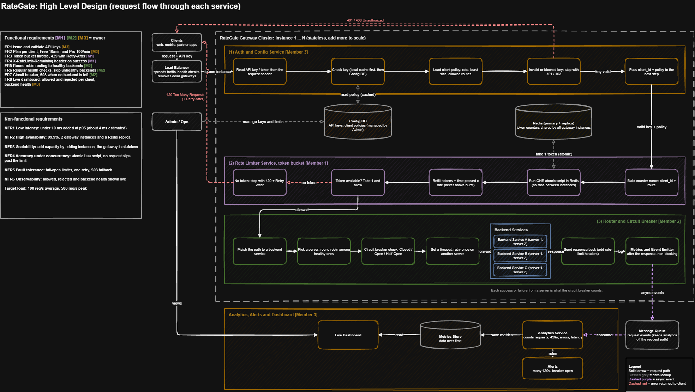

# RateGate

RateGate is a high-level design for an API gateway with client authentication, rate limiting, and resilient backend routing.

## Architecture

## Request flow

Requests pass through API key validation and a shared Redis token bucket, then route to a healthy backend. Rate-limited requests receive `429`; unavailable services return `503`. Usage events are sent asynchronously for analytics and alerts.

## Files

- `rategate_hld_detailed_final-1. Architecture.drawio.svg` — architecture diagram shown above
- `rategate_hld_detailed_final.drawio` — editable diagrams.net source
- `RateGate_Project_Report.pdf` — project report
